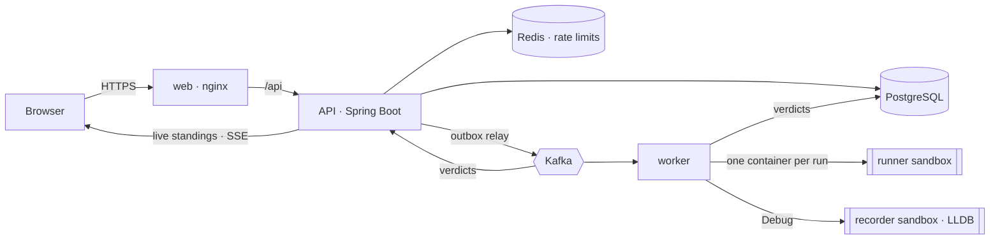

# VoidRun

An online judge with community contests and a step-by-step debugger.

- **Practise:** solve problems in C++17, Java 21 or JavaScript (Node.js) in a browser editor. Run against the samples or your own input, then submit against hidden tests and see a verdict per test.
- **Debug by replaying:** press **Debug** on a C++ program to record its run once, then step forwards and backwards through it line by line, with the call stack, every variable and the output so far. A compile error opens an editor with the errors marked, so you can fix the code and debug again on the spot.
- **Compete:** register for timed rounds under Codeforces, ICPC, AtCoder or IOI rules. Standings update live, and the editorial is released when the round ends.
- **Host:** write problems, or import them (and their editorials) from Codeforces or AtCoder, then set up a contest in four steps, invite co-authors and publish. Hosting needs a Host plan, paid through Razorpay or a built-in test checkout during development.
- **Profiles and people:** activity heatmaps, contest finishes, and ⌘K search for anyone, any problem, any round. There are five themes: Light, Sand, Emerald, Dark and Midnight.

## Quick start

You need **Docker** (Docker Desktop on macOS or Windows) and **make**.

```bash
cp .env.example .env        # optional settings: sign-in providers, payments
make up                     # builds everything and starts it
```

Then open **http://localhost:5173**. The first `make up` builds the two sandbox images and every service, which takes a few minutes.

| Address | What |
|---|---|
| http://localhost:5173 | The web app |
| http://localhost:8080/actuator/health | API health |

Useful commands:

```bash
make logs                       # follow the API and worker logs
make down                       # stop (keeps your data)
make make-admin NAME=<username> # give an account the admin role
make help                       # every target
```

## Settings

Everything is configured in one file, **`.env`**, copied from [`.env.example`](.env.example). Git ignores it, so your keys never get committed. Everything works without it, apart from the optional features below.

| Feature | Settings | Without them |
|---|---|---|
| Sign in with Google / GitHub | `GOOGLE_CLIENT_ID` / `_SECRET`, `GITHUB_CLIENT_ID` / `_SECRET` | Email and password sign-in only |
| Real payments for Host plans | `RAZORPAY_KEY_ID`, `RAZORPAY_KEY_SECRET`, `RAZORPAY_WEBHOOK_SECRET` | A test checkout that moves no money (`TEST_PAYMENTS=true`) |
| Free hosting for everyone | `HOST_PLAN_REQUIRED=false` | Hosting needs a plan; admins never do |
| Production | `DOMAIN`, `FRONTEND_URL`, `JWT_SECRET`, `POSTGRES_PASSWORD` | Local defaults |

After changing `.env`, run `make up` again (or `docker compose up -d api` for API settings). Step-by-step setup for each provider is in [docs/DEPLOY.md](docs/DEPLOY.md).

## Developing

Run the services on your machine for fast reloads, with only the infrastructure in Docker:

```bash
make infra          # PostgreSQL, Redis and Kafka
make api            # the API on :8080 (needs JWT_SECRET exported; applies migrations)
make worker         # the judge and replay worker (needs Docker and the sandbox images)
make web            # the Vite dev server on :5173, proxying /api to :8080
```

The backend needs **Java 21** (`JAVA_HOME`), and the frontend needs **Node.js 20+**. To point the dev server's proxy somewhere else, set `VITE_API_PROXY_TARGET`.

### Tests

```bash
make test           # everything
make test-api       # backend unit + integration tests (Testcontainers: needs Docker)
make test-web       # frontend tests (Vitest + Testing Library)
make check          # type check, all tests and a production build
```

## How it works



- **Submissions go through Kafka.** The API writes a submission and its event in one database transaction (a transactional outbox), and a relay publishes the event. Workers consume it, judge the code and write the verdict, so nothing is lost or judged twice.
- **Queues are separate.** Interactive runs, practice submissions, contest submissions, debug recordings and verdicts each have their own topic and worker pool. Contest submissions go first, so a practice burst never slows a live round.
- **Sandboxes.** Every execution gets its own container with no network, a read-only file system, no Linux capabilities, an unprivileged user and limits on memory, CPU and processes.
- **Live standings.** Each API instance follows the verdict topic and pushes standings to the browser over Server-Sent Events.

More detail: [docs/ARCHITECTURE.md](docs/ARCHITECTURE.md).

## Project layout

```
.
├── .env.example            every setting, documented (copy to .env)
├── Makefile                make help
├── docker-compose.yml      PostgreSQL · Redis · Kafka · API · worker · web
├── docker-compose.prod.yml production overrides: HTTPS with Caddy, nothing else public
├── deploy/Caddyfile        the HTTPS front for production
├── backend/                Java 21 · Spring Boot 4 · Maven multi-module (see backend/README.md)
│   ├── voidrun-api/          REST API, sign-in, contests, billing, problem import, outbox relay
│   ├── voidrun-worker/       judges runs and submissions, records Debug replays
│   ├── voidrun-recorder/     the execution recorder: LLDB tracer, keyframes and deltas, replay cursor
│   ├── voidrun-schema/       database migrations (Flyway)
│   ├── voidrun-common/       languages, verdicts, Kafka topics, event payloads
│   ├── docker/               Dockerfiles for the API, worker and the two sandboxes
│   └── scripts/              seed data generator, load test
├── frontend/               React 18 · TypeScript · Vite · Tailwind · Monaco · React Query
│   └── src/
│       ├── pages/            problems, contests, host, profiles, replays, admin
│       ├── components/       layout, editor, contest and replay building blocks
│       ├── api/              typed API client
│       └── test/             Vitest tests
└── docs/
    ├── API.md                every endpoint
    ├── ARCHITECTURE.md       how a submission travels; the reliability rules
    ├── DEPLOY.md             sign-in providers, Razorpay, going live
    ├── DEPLOY-AZURE.md       step by step: GitHub to a live Azure VM
    ├── history/              notes from the earlier Rust version
    └── specs/                the original specification documents
```

## Deploying

One Linux server with Docker runs everything:

```bash
cp .env.example .env   # set DOMAIN, FRONTEND_URL, JWT_SECRET, POSTGRES_PASSWORD
make prod-up           # builds, starts, and gets an HTTPS certificate
```

The full walk-through is in [docs/DEPLOY.md](docs/DEPLOY.md), and for Microsoft Azure in [docs/DEPLOY-AZURE.md](docs/DEPLOY-AZURE.md). Platforms such as Vercel, Netlify or Azure Container Apps can't run the judge, because it starts a sandbox container per run.
