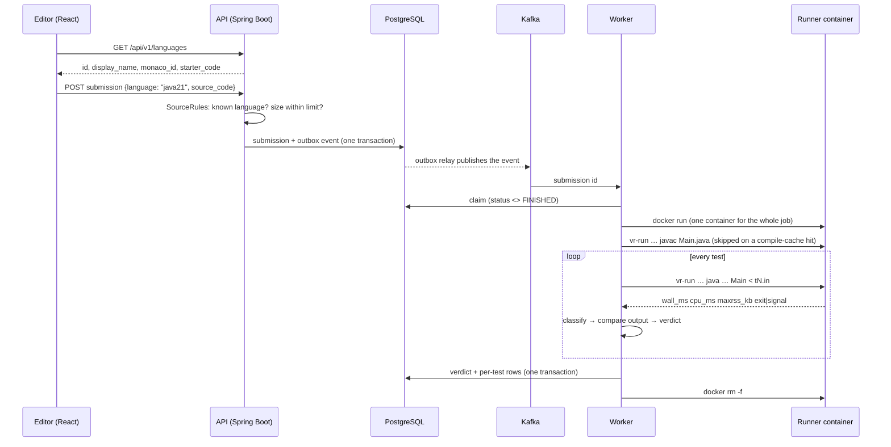

# Languages: how Java and JavaScript (Node.js) submissions are judged

VoidRun judges three languages: **C++17**, **Java 21** and **JavaScript on Node.js 22**.
This page follows a Java or Node.js submission from the editor to its verdict,
and lists every flag and limit that applies along the way. The last sections
cover adding a language and how the Java backend and the Node.js-built
frontend fit together.

| | C++17 | Java 21 | JavaScript (Node.js 22) |
|---|---|---|---|
| Wire id (stored with every run and submission) | `cpp17` | `java21` | `node22` |
| Source file in the sandbox | `main.cpp` | `Main.java` | `main.js` |
| Compile | `g++ -std=c++17 -O2 -pipe -I/opt/voidrun/pch -o main main.cpp` | `javac -J-Xmx512m -J-XX:+UseSerialGC -encoding UTF-8 -d . Main.java` | none |
| Compile succeeds when | exit 0 and `main` exists | exit 0 and `Main.class` exists | always |
| Run | `./main` | `java -Xmx{M}m -Xss64m -XX:+UseSerialGC -XX:-UsePerfData -cp . Main` | `node --max-old-space-size={M} --stack-size=32000 main.js` |
| Time limit | ×1 | **×2** | **×2** |
| Memory cap | address space M + 64 MB | JVM heap `-Xmx{M}m` | V8 heap `--max-old-space-size={M}` |
| Out of memory detected by | peak RSS > M, or `std::bad_alloc` | `java.lang.OutOfMemoryError` on stderr | `heap out of memory` on stderr |
| Debug (step-through replay) | yes | no | no |

`M` is the problem's memory limit in MB. A 1-second problem therefore gets 2
seconds of CPU time in Java or Node.js.

---

## 1. The journey of a submission



### 1.1 The language list is defined once

Everything about a language that the browser needs lives in one enum,
[`Language.java`](../backend/voidrun-common/src/main/java/dev/voidrun/common/Language.java)
in `voidrun-common`, which both the API and the worker depend on:

```java
JAVA21("java21", "Java 21", "java", /* starter code */),
NODE22("node22", "JavaScript (Node.js 22)", "javascript", /* starter code */);
```

- `id` is the stable value stored in the database. Never rename one: old
  submissions refer to it.
- `monacoId` is the Monaco editor's language mode (syntax highlighting).
- `starterCode` is what a new editor tab starts with.

`GET /api/v1/languages` (public,
[`MetaController`](../backend/voidrun-api/src/main/java/dev/voidrun/api/problems/MetaController.java))
returns this list. The editor
([`Workspace.tsx`](../frontend/src/components/Workspace.tsx)) builds its language
dropdown from it, so the frontend has no hard-coded language list. Drafts are
saved in `localStorage` per problem and language (`voidrun.draft.<slug>.<language>`),
so switching from Java to Node.js and back keeps both programs.

### 1.2 The API only accepts an id, never a command

[`SourceRules.language()`](../backend/voidrun-api/src/main/java/dev/voidrun/api/judge/SourceRules.java)
rejects an unknown id with `400 unsupported language; supported: cpp17, java21, node22`,
and `SourceRules.source()` rejects empty code or code over `max_source_bytes`
(see `GET /api/v1/limits`). Nothing a user sends can change a compiler flag or a
run command; those are fixed on the server in `Toolchain`.

The submission and its Kafka event are written in one database transaction
(the transactional outbox), then a relay publishes the event. Practice and
contest submissions go to different topics, so a burst of practice traffic
never delays a contest. See [ARCHITECTURE.md](ARCHITECTURE.md).

### 1.3 The worker: one container per job

[`JudgeService`](../backend/voidrun-worker/src/main/java/dev/voidrun/worker/judge/JudgeService.java)
claims the submission (`UPDATE … WHERE status <> 'FINISHED'`, so a duplicate
Kafka message is never judged twice) and opens a sandbox session.

[`DockerSandbox.open()`](../backend/voidrun-worker/src/main/java/dev/voidrun/worker/judge/DockerSandbox.java)
writes the source to `Main.java` or `main.js` in a fresh job directory and
starts **one** container of the runner image for the whole job:

```
docker run -d --network none --read-only --tmpfs /tmp:rw,size=128m
  --cap-drop ALL --security-opt no-new-privileges --user 65534:65534
  --pids-limit 256 --memory {C}m --memory-swap {C}m --cpus 1
  --ulimit nofile=256:256 -e HOME=/tmp -e TMPDIR=/tmp
  -v {job dir}:/work -w /work voidrun-runner sleep infinity
```

The container memory `C = max(1024, 2·M + 256)` MB is deliberately larger than
the problem's limit: it has to fit `javac` itself, and the JVM's memory beyond
its heap (metaspace, JIT code, thread stacks). The problem's real limit is
enforced inside, per test, by the heap flags.

The compile and every test are then `docker exec`s of
[`vr-run`](../backend/docker/runner/vr-run.c), a small static C program in the
image that:

- puts the program in its own process group with stdin, stdout and stderr redirected to files;
- sets a CPU-time limit (`RLIMIT_CPU`), an output-size limit (16 MB, `RLIMIT_FSIZE`),
  no core dumps and an unlimited stack;
- sets an address-space limit (`RLIMIT_AS`) only when it is non-zero;
- kills the whole group if the wall clock runs out (`2 × limit + 1 s`, for a program that sleeps or blocks);
- prints one line: `wall_ms=… cpu_ms=… maxrss_kb=… timed_out=0|1 exit=…` (or `signal=…`).

Measuring inside the container means container start-up and `docker exec`
overhead are never charged to the program. JVM and V8 start-up are part of
the program's own process, so they are charged; the time factor below pays for them.

### 1.4 The runner image

[`runner.Dockerfile`](../backend/docker/runner.Dockerfile) builds one image for
all three languages by copying the runtimes out of the official images:

```dockerfile
FROM eclipse-temurin:21-jdk AS java
FROM node:22-bookworm-slim AS node
FROM debian:trixie-slim
COPY --from=java /opt/java/openjdk /opt/java/openjdk
COPY --from=node /usr/local/bin/node /usr/local/bin/node
ENV JAVA_HOME=/opt/java/openjdk PATH=/opt/java/openjdk/bin:$PATH LANG=C.UTF-8
```

The build ends with `java -version && node --version`, so a broken runtime
fails the build instead of every submission. The image runs as `nobody`
(65534). Rebuild it with `make runner-image`.

---

## 2. Java 21 in detail

**What the program must look like.** The file is always saved as `Main.java`,
so the class with `main` must be **`public class Main`** with no `package` line.
Any other public class name is a compile error ("class X is public, should be
declared in a file named X.java"), shown to the user as **Compilation error**.
Other non-public classes in the same file are fine; their `.class` files are
picked up too.

Starter code:

```java
import java.io.*;
import java.util.*;

public class Main {
    public static void main(String[] args) throws IOException {
        BufferedReader in = new BufferedReader(new InputStreamReader(System.in));

    }
}
```

`BufferedReader` (and a `PrintWriter` or `StringBuilder` for output) is used
because `Scanner` and `System.out.println` in a loop are slow enough to cause
a time-limit verdict on large inputs.

**Compile:** `javac -J-Xmx512m -J-XX:+UseSerialGC -encoding UTF-8 -d . Main.java`

- `-J-Xmx512m` caps the compiler's own heap, so `javac` fits in the container.
- `-J-XX:+UseSerialGC` stops the compiler from starting parallel GC threads on a one-CPU sandbox.
- `-encoding UTF-8` lets comments and string literals contain any character.
- The compile has 30 seconds. It counts as a success only if `javac` exits 0
  **and** `Main.class` exists.

**Run:** `java -Xmx{M}m -Xss64m -XX:+UseSerialGC -XX:-UsePerfData -cp . Main`

- `-Xmx{M}m` makes the problem's memory limit the heap limit. Going over it
  throws `OutOfMemoryError`, which the worker reports as **Memory limit exceeded**.
- `-Xss64m` gives the main thread a 64 MB stack, so recursive DFS on 10⁵–10⁶
  nodes does not throw `StackOverflowError` (which would be a runtime error).
- `-XX:+UseSerialGC` uses one GC thread: the sandbox has one CPU and 256
  processes, and a parallel collector would only add start-up time and threads.
- `-XX:-UsePerfData` stops the JVM from writing `/tmp/hsperfdata_*` files on a read-only sandbox.

**Why no address-space limit:** the JVM reserves far more virtual memory than
it uses (the heap range, code cache, class space). An `RLIMIT_AS` of a few
hundred MB would make it fail to start. The heap flag is the limit instead, and
the container's memory cap is the backstop.

**Why time ×2:** JVM start-up, class loading and JIT warm-up cost roughly
0.1–0.3 s of CPU before `main` does any work, and interpreted code runs slower
until it is compiled. Doubling the limit is the common judge practice
(Codeforces and AtCoder adjust similarly).

---

## 3. JavaScript (Node.js 22) in detail

**What the program must look like.** A single CommonJS script saved as
`main.js`. Input is the whole of stdin, read at once:

```js
const input = require("fs").readFileSync(0, "utf8").split(/\s+/).filter(Boolean);
let pos = 0;
const next = () => input[pos++];
```

File descriptor `0` is stdin. Reading it synchronously in one call is both the
fastest way and the simplest: there are no `readline` callbacks to wait for.
Print with `console.log`, or better, build an array of lines and print
`out.join("\n")` once, because thousands of `console.log` calls are slow.
`require` works for Node's built-in modules only; there is no `npm install`
and no network.

**No compile step.** `Toolchain.compiled()` is false, so the compile phase
returns success at once and syntax errors appear at run time: Node prints a
`SyntaxError` to stderr and exits non-zero, giving **Runtime error** on the first test.

**Run:** `node --max-old-space-size={M} --stack-size=32000 main.js`

- `--max-old-space-size={M}` makes the problem's memory limit V8's heap limit.
  Going over it prints `FATAL ERROR: … JavaScript heap out of memory`, which
  the worker reports as **Memory limit exceeded**.
- `--stack-size=32000` (about 32 MB) raises V8's default stack of roughly
  1 MB, so deep recursion works. `vr-run` sets the process stack limit to
  unlimited, so V8 never runs past the real stack.

**Why no address-space limit and why time ×2:** the same reasons as Java. V8
reserves large virtual ranges, and start-up plus JIT warm-up costs time a
native program does not pay.

---

## 4. From an execution to a verdict

Each test produces an `ExecStatus`
(`DockerSandbox.classify`), checked in this order:

| Check | ExecStatus | Verdict |
|---|---|---|
| wall clock ran out, CPU time > limit × factor, or `SIGXCPU` | `TIME_LIMIT` | Time limit exceeded |
| `SIGXFSZ` (more than 16 MB of output) | `OUTPUT_LIMIT` | Runtime error |
| Java: `java.lang.OutOfMemoryError` on stderr · Node: `heap out of memory` on stderr · any `SIGKILL` that was not the timeout (the container's OOM killer) | `MEMORY_LIMIT` | Memory limit exceeded |
| any other signal | `SIGNALLED` | Runtime error |
| exit code ≠ 0 (an uncaught exception, `System.exit(1)`, a Node `SyntaxError`) | `NON_ZERO_EXIT` | Runtime error |
| exit 0 | `OK` | compare the output |

An uncaught Java exception makes the JVM exit with code 1, so
`ArrayIndexOutOfBoundsException` or `NullPointerException` is a runtime error;
the stack trace is kept as the test's stderr. A `StackOverflowError` is the same.

**Output comparison**
([`OutputCompare`](../backend/voidrun-worker/src/main/java/dev/voidrun/worker/judge/OutputCompare.java)),
identical for all languages: line endings are normalised, trailing spaces and
tabs on each line and trailing blank lines are ignored, and the rest must match
exactly. `1 2` and `12` differ, and so do `0.5` and `0.50`.

The first failing test decides the verdict and the remaining tests are
skipped. The verdict and the per-test rows are written in one transaction
with the same `status <> 'FINISHED'` guard, so only one result is ever kept.

**Runs** (the Run button, against samples or custom input) use the same
sandbox and limits; the outcome is reported per test instead of as one verdict.

---

## 5. The compile cache

[`CompileCache`](../backend/voidrun-worker/src/main/java/dev/voidrun/worker/judge/CompileCache.java)
stores compiled output keyed by `sha256(runner image, compile command, source)`.
For Java that is every `.class` file `javac` produced plus its warnings. A
Run followed by a Submit of the same code, a resubmission, or a rejudge skips
`javac` entirely (the API shows the compile time as empty for a cached build).
Including the image and the command in the key means upgrading the JDK or
changing a flag can never reuse a stale build. Node.js has nothing to cache.

---

## 6. Why Debug is C++ only

The step-through debugger records a run with LLDB in a separate recorder image
([`voidrun-recorder`](../backend/voidrun-recorder)): it single-steps native
code and reads variables from DWARF debug information. Java bytecode and V8's
JIT-compiled JavaScript have no such information at the machine level. A
recorder for them would need a different tracer (JDI for Java, the V8
inspector protocol for Node.js). The editor hides the Debug button for these
languages (`debuggable = language.id === "cpp17"` in `Workspace.tsx`), and the
API rejects a replay request for them.

---

## 7. Adding a language

Python 3 as an example:

1. **Runtime in the image.** In `backend/docker/runner.Dockerfile`, install it
   (`apt-get install -y python3`) and add `python3 --version` to the final
   check. Run `make runner-image`.
2. **The enum.** Add `PY3("py3", "Python 3", "python", "import sys\n…")` to
   `Language.java`. The id is permanent.
3. **The toolchain.** In `Toolchain.java` add
   `case PY3 -> new Toolchain("main.py", List.of(), null, 3);` and
   `case PY3 -> List.of("python3", "main.py");`. Decide on an address-space
   limit (CPython works with one, unlike the JVM).
4. **Out-of-memory detection.** Add `case PY3 -> stderr.contains("MemoryError");`
   to the switch in `DockerSandbox.classify`. The switches have no `default`,
   so the compiler points at every place a new language needs a decision.
5. **Tests.** Add the language to the worker's sandbox integration tests:
   accepted, wrong answer, time limit, memory limit and runtime error.

The frontend needs no change: the dropdown, syntax mode and starter code come
from `GET /api/v1/languages`.

---

## 8. Java backend and Node.js frontend

The other half of "Java and Node.js" in this project is the application itself:
the server is Java and the web app is built with Node.js.

| | Backend | Frontend |
|---|---|---|
| Language | Java 21 | TypeScript |
| Framework | Spring Boot 4 (Maven modules) | React 18, built by Vite on Node.js 22 |
| In production | `voidrun-api` and `voidrun-worker` containers | static files served by nginx; Node.js is only used to build them |

**Node.js is a build tool here, not a server.** The frontend
[`Dockerfile`](../frontend/Dockerfile) runs `npm ci` and `npm run build` in a
`node:22` stage, then copies the output into an `nginx` image. No Node.js
process runs in production.

**How they talk.** The browser only ever talks to one origin, so there is no
CORS to configure:

```
Browser ──▶ nginx (web, :5173 locally, behind Caddy in production)
             ├─ /                      → the React app (index.html, JS, CSS)
             ├─ /api/…                 → api:8080 (Spring Boot REST, JSON in snake_case)
             ├─ /api/v1/contests/*/live → api:8080 with buffering off (Server-Sent Events)
             └─ /oauth2/…, /login/oauth2/… → api:8080 (Google and GitHub sign-in)
```

During development `make web` runs Vite's dev server instead, and
[`vite.config.ts`](../frontend/vite.config.ts) proxies the same paths to
`localhost:8080` (or `VITE_API_PROXY_TARGET`).

- **Client.** [`src/api/client.ts`](../frontend/src/api/client.ts) prefixes every
  request with `/api/v1`, adds `Authorization: Bearer <access token>`, and turns
  error bodies into an `ApiError` with the server's `code` (for example
  `HOST_PLAN_REQUIRED`). Types in `src/api/types.ts` mirror the Java DTOs.
- **Sign-in.** The API issues a short-lived JWT access token, kept in memory
  only, and a rotating refresh token, kept in `localStorage`. On a 401 the client
  refreshes once (one request shared by all callers, since a refresh token
  works only once) and retries.
- **OAuth.** The browser is sent to Spring Security's `/oauth2/authorization/google`;
  after the provider returns, the API redirects to `/auth/callback?code=…` with a
  one-time code, never a token in the URL, which the app exchanges via
  `POST /api/v1/auth/oauth/exchange`.
- **Live data.** Standings use `EventSource` on `/api/v1/contests/{slug}/live`;
  verdicts and replays are polled with React Query.

Every endpoint is listed in [API.md](API.md).
